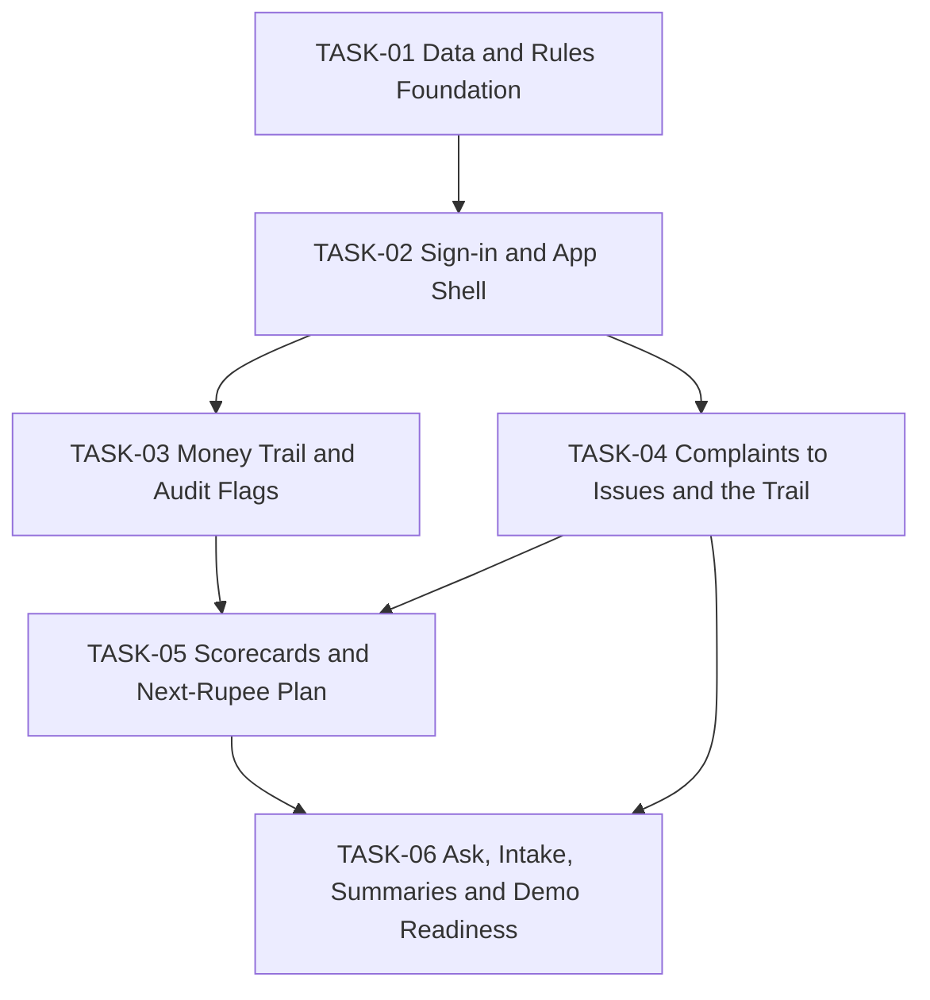

# Task Summary — BMC Sathi

**Last Updated:** 2026-11-21
**Overall Progress:** 6 / 6 tasks complete (100%)
**Current Task:** None (all complete)
**Source Documents:** `docs/PRD-bmc-sathi.md`, `docs/tech-spec/`

## How to use this plan

Read this file first in any session. Then open only the task file you are executing; each is written to stand alone. Open a spec document only at the anchor a task names.

## Status Board

| Task | Title | Status | Priority | Size | Depends On | Progress |
|---|---|---|---|---|---|---|
| TASK-01 | Data and Rules Foundation | Complete | P0 | M · 1.5 h | None | 100% |
| TASK-02 | Sign-in and App Shell | Complete | P0 | M · 1.5 h | TASK-01 | 100% |
| TASK-03 | Money Trail and Audit Flags | Complete | P0 | L · 2.0 h | TASK-02 | 100% |
| TASK-04 | Complaints to Issues and the Trail | Complete | P0 | M · 1.5 h | TASK-02 | 100% |
| TASK-05 | Scorecards and Next-Rupee Plan | Complete | P0 | M · 1.5 h | TASK-03, TASK-04 | 100% |
| TASK-06 | Ask, Intake, Summaries and Demo Readiness | Complete | P0 | M · 1.5 h | TASK-04, TASK-05 | 100% |

Total estimate: 9.5 hours.

Status vocabulary: `Not Started`, `In Progress`, `Blocked`, `In Review`, `Complete`.

## Execution Order

1. TASK-01 → 2. TASK-02 → 3. TASK-03 → 4. TASK-04 → 5. TASK-05 → 6. TASK-06

**Ready now (dependencies satisfied):** none; all tasks complete
**Blocked:** none. TASK-04 (Claude mode), TASK-06 (Ask, summaries) need `ANTHROPIC_API_KEY`; both have a working mode without it.

TASK-03 and TASK-04 both depend only on TASK-02. Start the TASK-04 pipeline run as soon as TASK-01 is loaded if a Claude key is available, since it runs unattended.

## Dependency Graph

## Requirement Coverage

| Category | Requirements | Covered | Uncovered |
|---|---|---|---|
| Functional (REQ-F) | 38 | 38 | — |
| Data (REQ-D) | 8 | 8 | — |
| Non-Functional (REQ-N) | 7 | 7 | — |
| Security (REQ-S) | 7 | 7 | — |
| Operational (REQ-O) | 4 | 4 | — |

3 requirements are deferred. Full mapping: [requirements-registry.md](./requirements-registry.md)

## If time runs short

Cut in this order (PRD §11): social post labelling (TASK-04), Marathi summaries (TASK-06), intake for complaints (TASK-06), ward scorecards (TASK-05), dark-theme polish (TASK-02). Never cut: `verify`, the flag queue and evidence, contractor scorecards, the plan.

## Progress Management Protocol

After each completed implementation and its commit:

1. Update the task file: progress log row (date, what landed, commit ref), `Status`, and the completion checklist.
2. Update this file: task status, overall progress, current task, newly unblocked tasks.
3. Update `requirements-registry.md` if coverage moved between tasks.
4. Re-run the validator on `docs/tasks/` and fix anything it reports.

A task is `Complete` only when its acceptance criteria have been verified in the running application, not when the code is written.

## Open Questions & Assumptions

| # | Item | Raised by | Status | Impact if wrong |
|---|---|---|---|---|
| 1 | Judges' answer key is unpublished; flag thresholds and risk weights are inferred | Plan | Open | Audit and budget scores; both are settings and can be tuned |
| 2 | Claude API key to be added to `apps/api/.env` by the owner | Owner | Open | No translations, summaries or Ask until added; everything else works |
| 3 | Database is local Postgres in Docker; Neon deferred | Owner | Decided | None for the demo; switch by `DATABASE_URL` |
| 4 | Next-rupee plan is built after the complaint pipeline, reversing PRD §11 | Plan | Decided | None; the plan ranks issues the pipeline creates |
| 5 | Scorecard and plan views are created in TASK-05, not in the first views migration | Plan | Decided | None; an extra migration |

## Related Documentation

| Document | Purpose |
|---|---|
| `docs/PRD-bmc-sathi.md` | Scope, roles, features, demo script, cut list |
| `docs/tech-spec/00-master-index.md` | Reading order and reference figures |
| `docs/tech-spec/01-project-overview.md` | Architecture, configuration, security, testing |
| `docs/tech-spec/04-database-design.md` | Tables, views, rules |
| `docs/tech-spec/03-backend-spec.md` | API, pipeline, Ask |
| `docs/tech-spec/02-frontend-spec.md` | Screens, theme, language |
| `docs/design/design-brief-bmc-sathi.md` | Design brief for generating screen and component designs |

## Change Log

| Date | Change |
|---|---|
| 2026-11-21 | Initial plan generated from PRD v1.0 and tech spec v1.0 |
