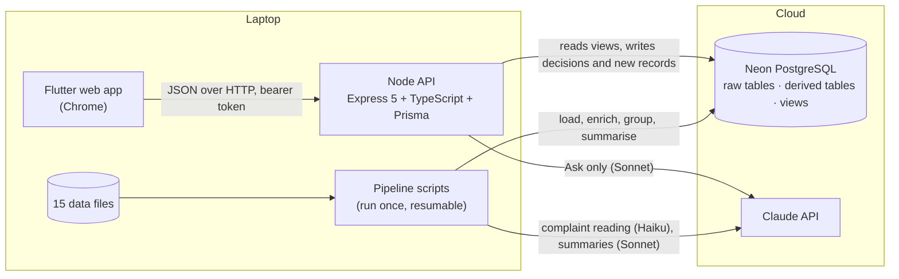
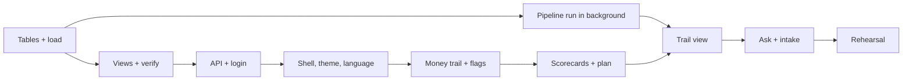

# Project Overview & Architecture

**Project:** BMC Sathi (Module 1: Roads)
**Version:** 1.0
**Last Updated:** 2026-11-21
**Status:** Draft

## Related Documents

- [00 Master Index](./00-master-index.md): entry point and reading order
- [02 Frontend Specification](./02-frontend-spec.md): screens, theme, state, language
- [03 Backend Specification](./03-backend-spec.md): API, auth, Claude pipeline, Ask
- [04 Database Design](./04-database-design.md): tables, views, audit and scoring rules
- [PRD](../PRD-bmc-sathi.md): what is being built and why

---

## 1. Purpose

BMC Sathi shows, for each Mumbai ward, where road repair money went, whether the repairs lasted, and where the next rupee should go. This suite describes how to build the demo version in 6 to 10 hours. Product scope, roles and acceptance checks are in the PRD and are not repeated here.

## 2. Constraints

| Constraint | Effect on the design |
|---|---|
| 6 to 10 hours, one builder with Claude Code | One repository, no CI, no deployment, one automated check that matters (§8) |
| Audit accuracy is the largest judging criterion | Flags and scores are SQL, never model output |
| Demo runs on a projector at a venue | Only one feature needs Claude live; a local database copy is the network fallback |
| Must run on real BMC data later | Raw tables mirror the supplied files; thresholds and weights are rows in a settings table |

## 3. System architecture

**Three parts:**

1. **Pipeline.** Command-line scripts that load the files, call Claude to read complaints, group complaints into issues and store written summaries. Run once before the demo; safe to rerun.
2. **Database.** Holds the raw data, what the pipeline produced, and the views that compute flags, scorecards and the next-rupee ranking on every read.
3. **API and web app.** The API reads views and records flag decisions and new records. The web app renders them for three roles.

**Why rules live in views:** a new work order inserted through the API is flagged, counted in ward spend and reflected in the contractor's scorecard on the next read, with no recompute step. At 2,499 work orders every view returns in well under a second.

## 4. Technology

| Layer | Choice | Version line | Notes |
|---|---|---|---|
| Web app | Flutter (web target) | Flutter stable, Dart 3 | Riverpod, go_router, dio, flutter_map, shared_preferences, intl, as in Saarthee |
| API | Node.js, Express 5, TypeScript | Node 22 LTS | Zod validation, jsonwebtoken, bcryptjs |
| Data access | Prisma | 6.x | Models for tables; views created by raw SQL migration and read with parameterised raw queries |
| Database | PostgreSQL on Neon | 17 | No PostGIS. Distances are computed in the pipeline (see [04 §6](./04-database-design.md#6-pipeline-derived-data)) |
| Claude | Anthropic TypeScript SDK | current | `claude-haiku-5-5` for complaint reading and social post sorting; `claude-sonnet-5-5` for summaries and Ask |

## 5. Repository layout

| Path | Contents |
|---|---|
| `data/` | The 15 supplied files, unchanged |
| `docs/` | PRD and this suite |
| `apps/api/` | Express API, Prisma schema and migrations, pipeline scripts |
| `apps/api/prisma/` | Schema, migrations (tables, then one SQL migration for all views), seed for users and settings |
| `apps/api/src/modules/` | One folder per API area: auth, wards, flags, contractors, plan, trail, ask, intake |
| `apps/api/src/pipeline/` | `load`, `enrich`, `group`, `summarise`, `verify` scripts |
| `apps/web/` | Flutter app |
| `apps/web/lib/core/` | Theme, language, API client, formatting, shared widgets |
| `apps/web/lib/features/` | One folder per screen group |

## 6. Environments and configuration

One environment: the demo laptop. The API reads its settings from an environment file that is not committed.

| Variable | Purpose |
|---|---|
| `DATABASE_URL` | Neon pooled connection string. Point it at local Postgres to switch to the fallback |
| `DIRECT_URL` | Neon direct connection string, used by Prisma migrations |
| `ANTHROPIC_API_KEY` | Used by the pipeline and the Ask endpoint. Never sent to the web app |
| `JWT_SECRET` | Signs session tokens |
| `PORT` | API port, default 4000 |
| `WEB_ORIGIN` | The one origin allowed by CORS |

The web app takes the API base URL as a build-time define.

**Network fallback.** Before the demo, restore a dump of the Neon database into a local Postgres 17 (Docker). If venue wifi fails, change `DATABASE_URL` and restart the API. Everything works except Ask.

## 7. Security

Sized for a demo with synthetic data. Items marked *later* are needed before real data.

| Area | Demo build | Later |
|---|---|---|
| Sign-in | Three seeded accounts, bcrypt password hashes, JWT valid 12 hours | BMC single sign-on |
| Authorisation | Role and ward checked on every route by middleware ([03 §3](./03-backend-spec.md#3-authentication-and-roles)) | Per-department roles |
| Input | Zod schema on every route; unknown keys dropped; parameterised SQL only | same |
| Secrets | Environment file, not committed; API key server-side only | Secret manager |
| Personal data | Only the anonymised `complainant_id` is stored. It is not returned to the citizen role | Review against real complaint fields |
| Claude input | The Ask question is passed as data alongside fetched facts; the model has no tools and cannot query the database | same |
| Abuse | Ask limited to 10 requests a minute per user and 500 characters | Wider rate limits |
| Transport | HTTP on localhost | HTTPS |

## 8. Testing

Kept to what protects the score.

| Check | What it proves | When |
|---|---|---|
| **`verify` script** | City spend is ₹13.43 crore; 109 over-billed, 45 double-billing and 493 DLP flags; 24 wards and 8 contractors have scorecards; every ward has a plan | After load, and after any change to a view |
| Contrast test | Every text and background token pair meets WCAG AA in light and dark | With the theme |
| Role test | A citizen token is refused on decision and intake routes; a ward officer is refused another ward's intake | With auth |
| Manual run of the demo script | The eight steps in PRD §10 work end to end | Before the demo |

No other automated tests are in scope.

## 9. Performance targets

| Measure | Target |
|---|---|
| Any API read | Under 500 ms against Neon |
| First load of the web app | Under 5 s on the laptop |
| Ask answer | Under 10 s; 20 s timeout |
| Complaint pipeline, full run | Under 15 minutes |

## 10. Build order

Follows PRD §11. The dependency that matters: start the complaint pipeline run as soon as the tables are loaded, so it finishes while the screens are being built.

## Decisions & Assumptions

| # | Decision/Assumption | Rationale | Status | Date |
|---|---|---|---|---|
| 1 | Flutter web, Node + Express + TypeScript, Neon PostgreSQL | Chosen by the owner | Confirmed | 2026-11-21 |
| 2 | Prisma for data access | Chosen by the owner, matches Saarthee | Confirmed | 2026-11-21 |
| 3 | API and web app run on the laptop; Neon in the cloud | Chosen by the owner | Confirmed | 2026-11-21 |
| 4 | Local Postgres copy as network fallback | Venue wifi is the main demo risk | Assumed | 2026-11-21 |
| 5 | Haiku 5.5 for the pipeline, Sonnet 5.5 for summaries and Ask | Chosen by the owner | Confirmed | 2026-11-21 |
| 6 | No PostGIS; distances computed in the pipeline | 291 road segments; avoids an extension and raw geometry SQL | Assumed | 2026-11-21 |
| 7 | No CI, no deployment, one verification script | Build window | Assumed | 2026-11-21 |
| 8 | Lean suite: four documents plus index; security, hosting and build order folded in here | Chosen by the owner | Confirmed | 2026-11-21 |

## Version History

| Version | Date | Author | Changes |
|---|---|---|---|
| 1.0 | 2026-11-21 | Keyur Patel with Claude | Initial draft |
