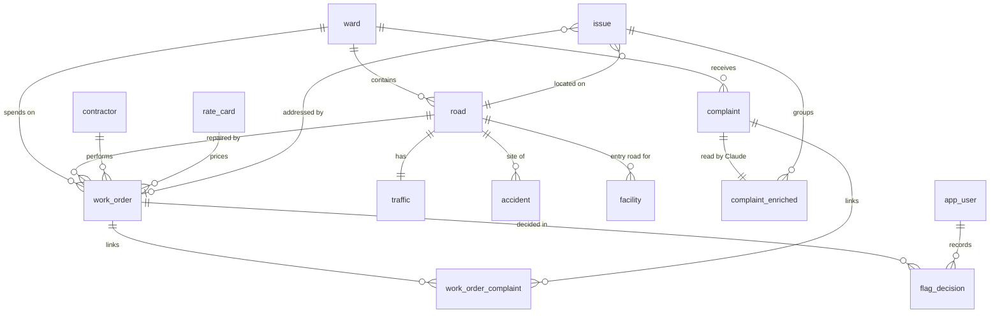

# Database Design

**Project:** BMC Sathi (Module 1: Roads)
**Version:** 1.0
**Last Updated:** 2026-11-21
**Status:** Draft

## Related Documents

- [00 Master Index](./00-master-index.md): entry point and reading order
- [01 Project Overview & Architecture](./01-project-overview.md): system shape, security, testing
- [02 Frontend Specification](./02-frontend-spec.md): screens that read these views
- [03 Backend Specification](./03-backend-spec.md): API routes and the pipeline that fills the derived tables
- [PRD](../PRD-bmc-sathi.md): rule definitions in product terms

---

## 1. Overview

PostgreSQL 17 on Neon. Three groups of objects:

1. **Raw tables** mirror the 15 supplied files, one table per file, same column names.
2. **Derived and application tables** hold what the pipeline produces and what users record.
3. **Views** compute flags, scorecards and the next-rupee ranking on every read.

Prisma models cover groups 1 and 2. All views are created by one hand-written SQL migration and read through parameterised raw queries.

## 2. Conventions

- Table and column names are snake_case and match the data dictionary.
- Timestamps are `timestamp without time zone`, read as IST, as supplied.
- Money is `integer` rupees. Areas, coordinates and rates are `numeric`.
- `Y`/`N` columns in the files are stored as `boolean`.
- Blank values in the files are stored as null.

## 3. Raw tables

Columns are exactly those in `DATA_DICTIONARY.md`. Only keys, type changes and indexes are listed here.

| Table | Rows | Primary key | Foreign keys | Indexes |
|---|---:|---|---|---|
| `ward` | 24 | `ward_code` | | |
| `locality` | 118 | `(locality, ward_code)` | `ward_code` | |
| `road` | 291 | `road_id` | `ward_code` | `ward_code` |
| `traffic` | 291 | `road_id` | `road_id` | |
| `flood_hotspot` | 28 | `hotspot_id` | `ward_code` | `ward_code` |
| `facility` | 160 | `facility_id` | `ward_code`, `ambulance_entry_road` → `road` | `ambulance_entry_road` |
| `accident` | 420 | `accident_id` | `ward_code`, `road_id` | `road_id` |
| `rainfall_daily` | 244 | `(date, station)` | | |
| `tide` | 244 | `(date, high_tide_time)` | | |
| `rate_card` | 10 | `repair_method` | | |
| `contractor` | 8 | `contractor_id` | | |
| `complaint` | 6,501 | `complaint_id` | `ward_code` (nullable) | `ward_code`, `status`, `received_at` |
| `social_post` | 650 | `post_id` | | |
| `work_order` | 2,499 | `work_order_id` | `ward_code`, `road_id`, `contractor_id`, `repair_method` | `ward_code`, `road_id`, `contractor_id`, `(road_id, work_type, assigned_at)` |
| `work_order_complaint` | about 4,950 | `(work_order_id, complaint_id)` | both | `complaint_id` |

Notes:

- `work_order.linked_complaint_ids` is kept as supplied and also split into `work_order_complaint` at load.
- `ward.wards_geojson` and `road.geometry` are not stored. The web app ships `wards.geojson` and `roads.geojson` as assets.
- `work_order.source` (`text`, default `'import'`) is added to tell imported rows from rows entered through the app (`'intake'`). `complaint.source` likewise.
- `contractor_name` on `work_order` is dropped in favour of the join to `contractor`.

## 4. Derived and application tables

### `complaint_enriched`
One row per complaint, written by the pipeline (and by intake, without Claude fields).

| Column | Type | Notes |
|---|---|---|
| `complaint_id` | text, PK, FK → `complaint` | |
| `category_clean` | text | One of the six work types, or `not_road` |
| `severity` | smallint, 1 to 5 | Claude's estimate; null for intake rows until rerun |
| `text_en` | text | English translation; equals the original for English |
| `road_name_mentioned` | text, null | As extracted from the description |
| `ward_code_resolved` | text, FK → `ward` | Original if present, otherwise from location |
| `lat_resolved`, `lon_resolved` | numeric | GPS if present, otherwise locality centre |
| `location_source` | text | `gps`, `locality`, `work_order`, `none` |
| `road_id_resolved` | text, FK → `road`, null | See §6 |
| `issue_id` | integer, FK → `issue`, null | |
| `model` | text, null | Model that produced the Claude fields |
| `enriched_at` | timestamp | |

Indexes: `issue_id`, `road_id_resolved`.

### `issue`
A cleaned, de-duplicated problem at one place.

| Column | Type | Notes |
|---|---|---|
| `issue_id` | serial, PK | |
| `ward_code` | text, FK | |
| `road_id` | text, FK, null | Null only when no location could be resolved |
| `category` | text | One of the six work types |
| `severity` | smallint | Highest severity among its complaints |
| `first_reported_at`, `last_reported_at` | timestamp | |
| `complaint_count` | integer | |
| `upvotes_total` | integer | |
| `work_order_id` | text, FK, null, unique | Set when BMC linked these complaints to a job |
| `state` | text | `fixed`, `fixed_reopened`, `open`, `out_of_scope` |

Indexes: `ward_code`, `state`, `(road_id, category)`.

`state` is `out_of_scope` when every complaint in the issue was rejected or forwarded to another agency.

### `social_post_label`

| Column | Type | Notes |
|---|---|---|
| `post_id` | text, PK, FK | |
| `label` | text | `road_issue`, `thanks`, `sarcasm`, `noise` |
| `issue_id` | integer, FK, null | Set only for `road_issue` posts that match an issue by locality and date |
| `text_en` | text | |

### `summary`
Text written by Claude from computed figures.

| Column | Type | Notes |
|---|---|---|
| `subject_type` | text | `ward`, `contractor` |
| `subject_id` | text | Ward code or contractor id |
| `lang` | text | `en`, `mr` |
| `body` | text | |
| `facts_hash` | text | Hash of the figures it was written from |
| `generated_at` | timestamp | |

Primary key `(subject_type, subject_id, lang)`. When the current figures no longer match `facts_hash`, the API returns the summary with `stale: true` and the screen shows "written before recent changes".

### `flag_decision`

| Column | Type | Notes |
|---|---|---|
| `flag_type` | text | `overbilled`, `duplicate`, `dlp` |
| `work_order_id` | text, FK | |
| `decision` | text | `confirmed`, `needs_explanation`, `not_an_issue` |
| `note` | text | Up to 500 characters |
| `decided_by` | integer, FK → `app_user` | |
| `decided_at` | timestamp | |

Primary key `(flag_type, work_order_id)`. A later decision replaces the earlier one. A flag with no row here is `open`.

### `setting`

| Key | Default | Used by |
|---|---|---|
| `overbill_ratio` | 1.5 | Over-billed flag |
| `overbill_watch_ratio` | 1.3 | "Watch" tier |
| `dup_window_days` | 7 | Double-billing flag |
| `dup_area_tolerance` | 0.05 | Double-billing flag |
| `low_lying_cutoff` | 0.6 | Peer groups |
| `rain_moderate_mm`, `rain_heavy_mm` | 15, 65 | Peer groups |
| `band_min_jobs` | 30 | Scorecard bands |
| `band_z`, `band_z_strong` | 2, 3 | Scorecard bands |
| `w_severity`, `w_access`, `w_safety`, `w_traffic`, `w_flood`, `w_demand` | 30, 15, 15, 15, 15, 10 | Risk score (sum to 100) |
| `high_risk_score` | 70 | Method choice |
| `hotspot_radius_m` | 500 | Flood exposure |

Columns: `key` text PK, `value` numeric, `description` text.

### `app_user`

| Column | Type | Notes |
|---|---|---|
| `user_id` | serial, PK | |
| `username` | text, unique | |
| `password_hash` | text | bcrypt |
| `role` | text | `ward_officer`, `auditor`, `citizen` |
| `ward_code` | text, FK, null | Required for `ward_officer` |
| `display_name` | text | |

Seeded: `officer.e` (ward officer, Ward E), `auditor`, `citizen`.

### `road_proximity`
Computed once at load, because it does not change.

| Column | Type | Notes |
|---|---|---|
| `road_id` | text, PK, FK | |
| `near_hotspot_id` | text, FK, null | Nearest flood hotspot within `hotspot_radius_m` of the segment |
| `hotspot_tide_sensitive` | boolean | |
| `hospital_entry_count` | integer | Hospitals with emergency services using this as their entry road |
| `school_count` | integer | Schools whose nearest road this is |

## 5. Views

All views read settings from `setting`. Names are prefixed `v_`.

### 5.1 Cost and context

**`v_work_order`**: one row per work order with:

- `expected_cost`: `area_sqm × standard_rate_inr` when the method's unit is per sqm, otherwise `standard_rate_inr`.
- `cost_ratio`: `cost_inr ÷ expected_cost`.
- `road_under_dlp`, `road_type`, `surface` from `road`.
- `has_complaint`: whether any row exists in `work_order_complaint`.
- `rain_band`: `dry`, `moderate` or `heavy`, from the highest rainfall at either station on the completion date, against the two rain settings.
- `ward_type`: `low_lying` when the ward's index is at or above the cutoff, otherwise `normal`.

Every other view builds on this one.

### 5.2 Flags

**`v_flag`**: the union of three queries, each returning `flag_type`, `work_order_id`, `ward_code`, `contractor_id`, `amount_at_stake`, `evidence` (JSON), `tier`, and the decision joined from `flag_decision` (or `open`).

| Flag type | Condition | Amount at stake | Evidence |
|---|---|---|---|
| `overbilled` | `cost_ratio > overbill_ratio` | `cost_inr − expected_cost` | Area, rate, expected cost, ratio |
| `duplicate` | No linked complaint, and an earlier work order exists on the same road with the same work type, same contractor, area within `dup_area_tolerance`, and `assigned_at` within `dup_window_days` before | `cost_inr` | The earlier work order's id, dates, area and cost |
| `dlp` | `road_under_dlp` and `cost_inr > 0` | `cost_inr` | Road, last resurfaced date |

- `tier` is `flag` for all three. A fourth query adds rows with `tier = 'watch'` and `flag_type = 'overbilled'` where the ratio lies between the watch and flag settings. Watch rows cannot take a decision.
- A work order can appear under more than one flag type. Totals of "money in open flags" count each work order once, taking the largest amount.

**Expected on the supplied data:** 109 `overbilled`, 45 `duplicate`, 493 `dlp`, 5 watch.

### 5.3 Money trail

**`v_ward_money`**: one row per ward: budget, spend, remaining (negative when overspent), spend as a share of budget, job count, `reopened_spend` (cost of jobs re-opened within 30 days), `dlp_spend`, `open_flag_amount`, `sla_met_rate`, `reopen_rate`.

**`v_ward_spend_breakdown`**: spend and job count per ward by contractor, by repair method and by ISO week of completion. One view with a `dimension` column.

### 5.4 Scorecards

The comparison is the same for contractors and wards; only the subject changes.

**Peer group (stratum):** `work_type × repair_method × rain_band × ward_type`.

**`v_stratum_rate`**: for each stratum: job count, on-time count, re-opened count.

**`v_scorecard`**: one row per subject (`subject_type` is `contractor` or `ward`) and measure (`speed`, `durability`):

1. `observed`: the subject's own rate (share on time; share re-opened).
2. `expected`: for each of the subject's jobs, take the rate of its stratum **with the subject's own jobs removed**, then average over the subject's jobs. This is what similar jobs achieved.
3. `z`: `(observed − expected) ÷ sqrt(expected × (1 − expected) ÷ jobs)`.
4. `band`:
   - `too_few` when jobs are below `band_min_jobs`;
   - `similar` when `|z|` is below `band_z`;
   - `above` or `below` from `band_z` up to `band_z_strong`;
   - `well_above` or `well_below` beyond that.
   For durability the sign is reversed so that "above" always means better.
5. Context columns: jobs in heavy-rain bands, jobs in low-lying wards, total jobs, total spend, wards worked.

A stratum left with fewer than 5 other jobs after removing the subject's own falls back to `work_type × repair_method`.

**Cost measure** (same view, measure `cost`): the subject's median `cost_ratio`, the count of jobs above `overbill_ratio`, and band `review` when that count is above zero, otherwise `typical`.

### 5.5 Next-rupee plan

**`v_method_durability`**: re-open rate and job count by `work_type × repair_method × road_type`, with a fallback row per `work_type × repair_method`.

**`v_open_issue_risk`**: one row per issue with `state = 'open'`. Each part is scaled 0 to 1, multiplied by its weight, and returned as its own column so the screen can show the breakdown.

| Part | Scaled value |
|---|---|
| Severity | `(severity − 1) ÷ 4` |
| Critical access | 1 if a hospital entry road, 0.5 if a school road only, else 0 |
| Safety record | Accidents on the road with cause Pothole, Waterlogged road or Uneven road / open chamber, weighted Minor 1, Grievous 2, Fatal 3; capped at 6 and divided by 6 |
| Traffic | Average of the road's percentile rank on peak-hour vehicles and on two-wheeler share; plus 0.1 if a bus route; capped at 1 |
| Flood exposure | 1 if within range of a hotspot (for waterlogging and drain issues, always; for others, 0.7); otherwise the ward's low-lying index × 0.5 |
| Demand | Percentile rank within the ward of `complaint_count + upvotes_total ÷ 10 + days open ÷ 7` |

`risk_score` is the sum, 0 to 100. `reasons` is a JSON list of the parts that contributed more than a quarter of their weight, each with a short label key the web app translates.

**`v_plan`**: `v_open_issue_risk` plus, per issue:

- `recommended_method`:
  - one-method work types: that method;
  - potholes and waterlogging on high-risk roads (highway or arterial, hospital entry road, bus route, or score at or above `high_risk_score`): the method with the lowest re-open rate in `v_method_durability` for that road type;
  - otherwise: the method with the lowest `rate × (1 + re-open rate)`.
- `alternative_method` with its cost and re-open rate, where one exists.
- `estimated_cost`: the rate for per-job methods; for per-sqm methods, the rate × the median `area_sqm` of past jobs of that work type in the ward.
- `cumulative_cost` in descending risk order within the ward, and `within_budget` (cumulative cost at or below the ward's remaining budget). For overspent wards `within_budget` is false for every row.

## 6. Pipeline-derived data

How the derived tables are filled. Steps and Claude prompts are in [03 §6](./03-backend-spec.md#6-pipeline).

**Resolving a complaint's road** (`road_id_resolved`), first match wins:

1. The complaint is linked to a work order: use that work order's road. `location_source = 'work_order'`.
2. GPS present: the road segment in the resolved ward with the smallest point-to-segment distance.
3. Claude extracted a road name that matches a `road_name` in the resolved ward: the segment of that road nearest the locality centre.
4. Locality matched in the gazetteer (name or any alias, case-insensitive, Devanagari included): nearest segment to the locality centre.
5. Otherwise null.

**Resolving the ward:** the supplied `ward_code`, else the gazetteer's ward for the locality, else the ward of the nearest road to the GPS point.

**Grouping into issues:**

- Complaints linked to the same work order form one issue, with `work_order_id` set. State is `fixed`, or `fixed_reopened` when the work order re-opened.
- Remaining complaints with status Open or In Progress are grouped by `road_id_resolved + category_clean`, splitting whenever more than 7 days pass between consecutive complaints. State is `open`.
- Remaining complaints marked Closed - Duplicate join the open or fixed issue on the same road and category whose date range contains them; otherwise they are dropped from grouping.
- Complaints that were rejected or forwarded form single-complaint issues with state `out_of_scope`.

## 7. Migrations and load

| Order | Step |
|---|---|
| 1 | Prisma migration: raw, derived and application tables |
| 2 | Raw SQL migration: all views, created in dependency order |
| 3 | Seed: `setting` defaults and three `app_user` rows |
| 4 | `load` script: reads the 15 files, inserts in batches, fills `work_order_complaint` and `road_proximity` |
| 5 | `verify` script ([01 §8](./01-project-overview.md#8-testing)) |

`load` empties and refills the raw tables, so it is safe to rerun. It does not touch `flag_decision`, `app_user` or `setting`.

Changing a view means adding a new SQL migration that drops and recreates it and any view that depends on it.

## 8. Real-data readiness

- Real exports map into the same raw tables. Extra columns are ignored at load.
- `road` needs an `original_contractor_id` column before the DLP flag can name the liable party.
- Thresholds are rows in `setting`. `overbill_ratio` should be reset from the observed spread on real data.
- If volumes grow past a few hundred thousand work orders, `v_work_order`, `v_scorecard` and `v_plan` become materialised views refreshed on write.

## Decisions & Assumptions

| # | Decision/Assumption | Rationale | Status | Date |
|---|---|---|---|---|
| 1 | Flags, scorecards and plan are views, not tables | "Live" was required; data is small | Confirmed | 2026-11-21 |
| 2 | Flag identity is `(flag_type, work_order_id)` | Stable across recomputation, so decisions survive | Assumed | 2026-11-21 |
| 3 | Scorecard band uses expected rate from peer strata and a z threshold | Keeps small gaps from being labelled; simple to compute in SQL | Assumed | 2026-11-21 |
| 4 | Risk weights 30/15/15/15/15/10 | Severity first, then the context factors the brief lists; all adjustable | Assumed | 2026-11-21 |
| 5 | Rain band uses rainfall on the completion date | One date per job keeps strata simple | Assumed | 2026-11-21 |
| 6 | Estimated area for open issues is the ward's median for that work type | Complaints carry no area | Assumed | 2026-11-21 |
| 7 | Geometry stays in asset files, not the database | No PostGIS; the map only needs to draw it | Assumed | 2026-11-21 |
| 8 | `engineer_remark` is stored and shown, never scored | It carries no signal in the supplied data | Confirmed | 2026-11-21 |

## Version History

| Version | Date | Author | Changes |
|---|---|---|---|
| 1.0 | 2026-11-21 | Keyur Patel with Claude | Initial draft |
